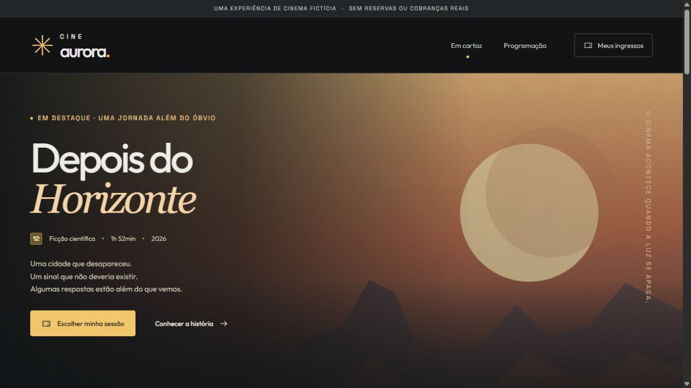

# Cine Aurora — histórias que ficam

Um cinema fictício com uma experiência completa: descobrir um filme, encontrar uma sessão, escolher assentos e emitir ingressos de demonstração.

**[Abrir demonstração gratuita](https://gustapaz.github.io/cine-aurora/)**



## Uma jornada do catálogo ao ingresso

- Seis filmes imaginários com sinopses, equipes fictícias e pôsteres vetoriais próprios.
- Catálogo com busca por título ou gênero, filtros e estado vazio.
- Programação de sete dias, com filtros por gênero e horário, totalizando 42 sessões demonstrativas.
- Páginas individuais de filmes com sessões, informações e metadados específicos.
- Mapa de 48 assentos por sessão, ocupação inicial determinística e escolha de até seis lugares.
- Navegação do mapa com setas, Home, End e Espaço, com um ponto de entrada por Tab.
- Conferência de ingressos inteiros e meias simuladas, validação de nome fictício e confirmação da natureza demonstrativa.
- Emissão com estado de processamento, conferência de disponibilidade local, confirmação e download de arquivo de texto.
- Carteira persistente com filtros, detalhes, download e cancelamento de ingressos fictícios. Cancelar libera os assentos na experiência local.
- Layouts para celular, tablet e desktop, navegação móvel, foco visível, modais nativos e suporte a movimento reduzido.

## Stack

**Svelte 5, SvelteKit 3, TypeScript e CSS**, com exportação estática pelo `adapter-static`. Vite no build, testes com o runner nativo do Node.js, checagem com `svelte-check` e formatação com Prettier.

Outfit e Space Grotesk são fontes servidas localmente. Pôsteres, paisagem, ícones e imagem social são autorais e incluídos no repositório. Os SVGs mantêm definição em qualquer tela e não dependem de provedores de mídia. A imagem social também tem versão PNG.

## Rodar localmente

Requer **Node.js 24** e npm.

```sh
npm ci
npm run dev
```

Acesse `/cine-aurora/` no endereço indicado pelo Vite.

```sh
npm run check       # Tipos e diagnósticos Svelte
npm run build       # Exportação estática em build/
npm test            # Regras e integridade da exportação
npm run preview    # Visualizar o build de produção
npm run format     # Formatar o código
npm run artwork    # Recriar pôsteres e imagem social
```

Execute o build antes dos testes para incluir a verificação dos arquivos exportados. Reinicie o preview caso gere um novo build enquanto ele estiver aberto.

## Arquitetura

```text
src/lib/
  components/      Ícones, SEO, cards, sessões e mapa de assentos
  data.ts          Filmes, sessões e lugares da sala
  domain.ts        Preços fictícios, disponibilidade e validação
  storage.ts       Carteira reativa e armazenamento local
  ticket.ts        Download do ingresso de demonstração
  config.ts        Base pública do repositório
src/routes/
  +page.svelte     Catálogo e apresentação
  filmes/[slug]/   Detalhes dos filmes
  programacao/     Programação filtrável
  sessao/[id]/     Seleção, conferência e emissão simulada
  ingressos/       Carteira local
  sobre/           Proposta, privacidade e créditos
scripts/
  artwork.mjs      Arte vetorial reproduzível e imagem social PNG
```

## Dados mockados, privacidade e limites

Não há cinema físico, filmes reais, sessões, reservas, vendas ou transações financeiras. As classificações etárias são ilustrativas. Os valores de R$ 32 e R$ 16 são dados de demonstração, sem validade comercial. Não há cartão, Pix, documentos ou comprovação de meia-entrada.

Não há backend, banco, API de aplicação, autenticação ou formulário enviado. O arquivo `sitemap.xml/+server.ts` é executado somente no build para gerar um XML estático; nenhum servidor de aplicação é publicado.

A carteira usa a chave `aurora-wallet` do `localStorage`, com nome fictício, código, sessão, assentos, quantidades, total ilustrativo, data e estado de cancelamento. Os registros recuperados são validados. A disponibilidade é conferida novamente antes de emitir. O armazenamento é compartilhado entre abas do mesmo navegador, mas **não oferece garantia transacional de concorrência nem sincronização entre dispositivos**. Isso não representa uma reserva real.

Quando o armazenamento não está disponível, a interface avisa e mantém o estado apenas na sessão atual. Limpar os dados do site remove a carteira. Downloads são gerados no cliente. O código visual dos ingressos é decorativo, não é um código de acesso escaneável.

Não há analytics, rastreadores, fontes remotas ou chamadas a serviços de aplicação. O GitHub Pages pode processar registros técnicos conforme a [política de privacidade do GitHub](https://docs.github.com/pt/site-policy/privacy-policies/github-general-privacy-statement).

## SEO e hospedagem

As 52 páginas de catálogo, conteúdo e sessões são pré-renderizadas em HTML. Títulos, descrições e canonical acompanham cada rota, com idioma declarado, favicon e metadados sociais. O sitemap inclui páginas editoriais e filmes; carteira e fluxos de emissão ficam fora dele. Nenhum dado estruturado de evento real é declarado.

As URLs terminam com `/` e funcionam com acesso direto e recarga no GitHub Pages. O workflow publica `build/` após checagens e testes, sem gerar commits de bot. A hospedagem é gratuita para este repositório público, sem faturamento, cartão ou trial.

A base é `/cine-aurora`, declarada em `src/lib/config.ts` e `vite.config.ts`. Ao renomear ou mover o projeto, atualize também os URLs de SEO, sitemap e README.

## Verificação

Os testes verificam preços ilustrativos, limites de seleção, assentos inválidos ou ocupados, liberação após cancelamento, recuperação de registros adulterados e integridade dos arquivos exportados. A checagem Svelte verifica tipos e avisos de componentes.

Inspeção no navegador cobre busca, estados vazios, filtros de programação, teclado no mapa, emissão, preço misto, download, persistência após recarga, cancelamento, retorno de foco do modal e layouts em celular, tablet e desktop. Não há pontuação Lighthouse ou certificação de acessibilidade declarada.

## Licenças

Código, ícones e ilustrações: [MIT](LICENSE), Gustavo Paz.

- Outfit: [SIL Open Font License](docs/OUTFIT-LICENSE.txt).
- Space Grotesk: [SIL Open Font License](docs/SPACE-GROTESK-LICENSE.txt).
- Bibliotecas e ferramentas mantêm suas próprias licenças.
